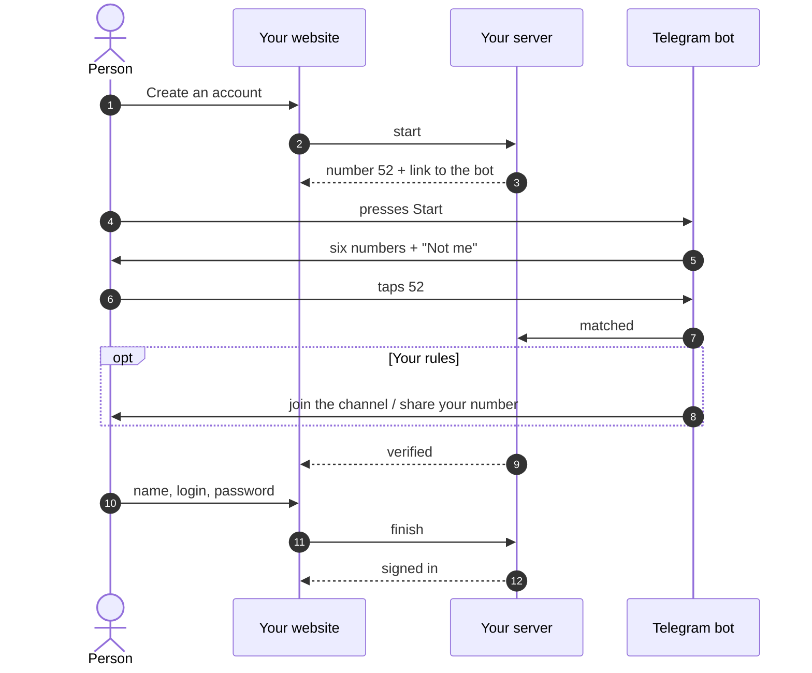
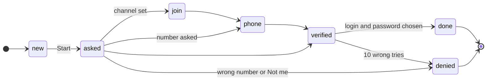

<div align="center">

# ✈️ tg-verify

**Telegram verification, sign-up and login for any website, from one slash command.**
No SMS bills. No email OTP. Just a bot, a number, and one tap.

[](#-usage)
[](#-whats-in-the-box)
[](#-fits-your-stack)
[](#-fits-your-stack)



[Usage](#-usage) · [How it works](#-how-it-works) · [Try the demo](#-try-it-without-a-bot) · [Go live](#-go-live-in-five-steps) · [Security](#-security) · [FAQ](#-faq)

</div>

---

## ✨ What you get

| | |
|---|---|
| 🔢 **Number matching** | The site shows two digits, the bot shows six buttons. Only the right tap counts, so a forwarded link is useless to an attacker. |
| 🔑 **Own login afterwards** | People verify once, then choose their own email (or username) and password. |
| ✈️ **Continue with Telegram** | Passwordless sign-in for everyone who is linked. |
| ♻️ **Forgot password** | Reset through the linked Telegram. No email server needed. |
| 🔗 **Link an old account** | Existing users attach Telegram instead of making a second account. |
| 📱 **Mobile number** | Ask, require, or don't ask. Telegram reveals it only when the person taps *Share*. |
| 📢 **Must-join channel** | Optional gate before an account can be created. |
| 🛠 **Admin page** | Connect the bot, set the rules, search everyone who verified, export CSV, unlink, see every request and why it stopped. |
| 🔔 **Staff alerts** | A Telegram message for each new account. |
| 🧪 **Tests included** | A mock bot, a pretend phone, and an end-to-end suite you can point at your own database. |

## 🚀 Usage

Open a Claude Code session **inside the project you want to add it to** and type:

```text
/tg-verify
```

That alone means *"add the whole system here"*. Anything you write after it overrides the defaults:

```text
/tg-verify mobile number required, must join @mychannel
/tg-verify login with username instead of email, keep the normal sign-up open too
/tg-verify only password reset and account linking, no sign-up changes
```

Plain words work as well, in English or Hinglish:

```text
add Telegram verification to the create account page
TG bot se verify karke signup wala system add karo
```

**What happens next:** Claude reads your project (runtime, users table, login routes, design), copies the server and client
files, wires them to *your* accounts, closes every other way to create an account, matches your site's look, tests the flow
with the mock bot, and tells you what is left for you to do.

<details>
<summary><b>Defaults it uses without asking</b></summary>
<br>

| Choice | Default |
|---|---|
| Who may sign up, once the bot is connected | Only people verified on Telegram |
| Mobile number | Ask, may be skipped |
| Must-join channel, staff alerts | Off |
| Login field | Whatever the site already uses |
| Minimum password | The site's own rule, else 6 |
| Routes | `/api/tg/*` |
| Who may change the bot | Owners; staff can look |
| Before the bot is connected | Nothing changes for visitors |

</details>

## 📥 Install

**Just this skill**

```powershell
# Windows (PowerShell)
git clone https://github.com/Arvind0099/my-claude-skills.git
Copy-Item -Recurse my-claude-skills\skills\tg-verify "$HOME\.claude\skills\"
```

```bash
# macOS / Linux
git clone https://github.com/Arvind0099/my-claude-skills.git
cp -r my-claude-skills/skills/tg-verify ~/.claude/skills/
```

Start a new session, and `/tg-verify` is there.

## 🔄 How it works





Every arrow is an atomic, conditional update, so double taps, retries and two open tabs can never finish a request twice.

## 🧪 Try it without a bot

No token, no database, nothing leaves your computer:

```bash
node skills/tg-verify/template/test/demo.mjs
# open http://127.0.0.1:8795
```

You get a sign-in page, an account page, the admin page **and a pretend phone** next to it. Press *Open Telegram* and the bot
answers on the phone. Accounts: `owner@site.test`, `staff@site.test`, `student@site.test`, password `secret1`.

Run the whole suite:

```bash
node skills/tg-verify/template/test/e2e.mjs
```

## 🛫 Go live in five steps

1. **Run the schema**: [`postgres.sql`](template/schema/postgres.sql) in the Supabase SQL editor, or [`sqlite.sql`](template/schema/sqlite.sql) with `wrangler d1 execute`.
2. **Make a bot**: [@BotFather](https://t.me/BotFather) → `/newbot` → copy the token.
3. **Connect it**: open the admin page on your live `https` site, paste the token, press **Connect**. The webhook is set for you and the token is stored encrypted.
4. **Set the rules**: who may sign up, mobile number, channel, alerts.
5. **Make a test account** from your phone.

> [!IMPORTANT]
> Paste the token into the admin page yourself. Don't send it in a chat, commit it, or put it in a command.

> [!NOTE]
> Connecting the bot closes the normal sign-up at once. Choose *Telegram, or without verification* on the same page to keep both.

## 🧩 Fits your stack

| | |
|---|---|
| **Runtime** | Cloudflare Workers, Node 20+ (Express, plain `http`), Next.js, Deno, Bun |
| **Database** | Supabase (REST, no SDK), Cloudflare D1, SQLite, Postgres. Only KV? Add D1 for three small tables. |
| **Updates** | Webhook, or polling for servers without public https |
| **Frontend** | Plain ES modules, no framework. Mount them anywhere, or rebuild the markup in your own components. |

<details>
<summary><b>Using it by hand, without Claude</b></summary>
<br>

```js
import { createTgVerify } from "./tg-verify.mjs";
import { d1Store } from "./store-sql.mjs";

const tg = createTgVerify({
  siteName: "My Site",
  secret: env.SESSION_SECRET,
  store: d1Store(env.DB),
  app: {
    findUser, findUsers, createUser, checkPassword, setPassword, deleteUser,
    signIn, currentUser, role, staffIds
  }
});

const res = await tg.handle(request, ctx);   // answers /api/tg/*, else null
if (res) return res;

// in your own sign-up route:
if (!await tg.plainSignupAllowed()) return refuse();
```

```js
import { api, mountTgAuth, mountTgLink } from "./tg-client.js";
import { mountTgAdmin } from "./tg-admin.js";

mountTgAuth(el, {
  signIn: (login, password) => api("/api/login", { login, password }),
  onSignedIn: () => location.assign("/")
});
mountTgLink(accountEl);
mountTgAdmin(adminEl);
```

The contracts for `app` and `store`, and a recipe per stack, are in [`references/adapting.md`](references/adapting.md).
A complete Worker with accounts is in [`template/examples/worker-d1.mjs`](template/examples/worker-d1.mjs).

</details>

## 📦 What's in the box

```text
tg-verify/
├── SKILL.md                     ← what Claude follows
├── references/
│   ├── adapting.md              ← config, contracts, a recipe per stack
│   ├── protocol.md              ← routes, states, keys, attacks it stops
│   └── checklist.md             ← pitfalls, tests, live checks
└── template/
    ├── server/                  ← the system + stores (SQL, Supabase, memory)
    ├── schema/                  ← postgres.sql, sqlite.sql
    ├── client/                  ← sign-in screens, account card, admin, QR, CSS
    ├── examples/worker-d1.mjs   ← complete working Worker
    └── test/                    ← e2e suite, mock Telegram, demo with a pretend phone
```

## 🔐 Security

| Attack | What stops it |
|---|---|
| Sending somebody your own login link | Number matching, device and place in the message, **Not me** |
| Reading the `t.me` link and polling it | A second key that only the browser has |
| A leaked database | Only hashes are stored; the bot token is encrypted with a key kept outside it |
| Forged webhook calls | Secret header, constant-time compare |
| Replays, double taps, two tabs | One-time keys, guarded state changes |
| Going around the verification | `plainSignupAllowed()` on every other sign-up route |
| Many accounts from one Telegram | Unique columns: one Telegram, one account |
| A banned person coming back | Checked at the start and at the end |
| Password guessing while linking | 10 tries per verification |
| Taking over a bot another site uses | Connect asks before moving it |

**What is kept, and people are told so on screen:** Telegram name, username, ID, language, premium, mobile if shared, times,
device, IP, city and country. Requests are deleted after 30 days. Check what privacy law asks of you where your users live.

## ✅ Tested

| | |
|---|---|
| In-memory store, D1 (local runtime), Supabase REST (local mock) | The full suite passes on all three |
| `worker-d1.mjs` | Run in a local Worker runtime with D1 and the mock bot |
| Do the tests catch mistakes? | 18 bugs planted on purpose, 18 caught |
| Screens | 360px and desktop, light and dark |
| **Not yet** | Real Postgres drivers, Express, Next.js and Deno/Bun, and the suite never talks to a real bot |

## ❓ FAQ

<details>
<summary><b>Does it cost anything?</b></summary>
<br>
The Telegram Bot API is free. There are no SMS or email charges.
</details>

<details>
<summary><b>Can I see everybody's phone number?</b></summary>
<br>
Only if they tap <i>Share my number</i>. Telegram gives it out no other way. You can make it required.
</details>

<details>
<summary><b>Can I use one bot on two sites?</b></summary>
<br>
No. A bot has one webhook. Connect warns you before it moves a bot that already works somewhere else.
</details>

<details>
<summary><b>What happens to people who already have accounts?</b></summary>
<br>
They keep signing in as before, and can link Telegram from their account page whenever they like.
</details>

<details>
<summary><b>Can the bot speak another language?</b></summary>
<br>
Yes. Pass <code>text</code> in the config to replace any sentence.
</details>

<details>
<summary><b>Changed the server secret and the bot stopped?</b></summary>
<br>
The stored token was sealed with the old secret. Paste the token again on the admin page.
</details>

---

<div align="center">

Part of [**my-claude-skills**](../../README.md) · crafted with ⚡ by [**@N4pst3rX**](https://t.me/N4pst3rX) · maintained by [Arvind0099](https://github.com/Arvind0099)

<sub>⭐ the repo if it saved you an evening.</sub>

</div>
